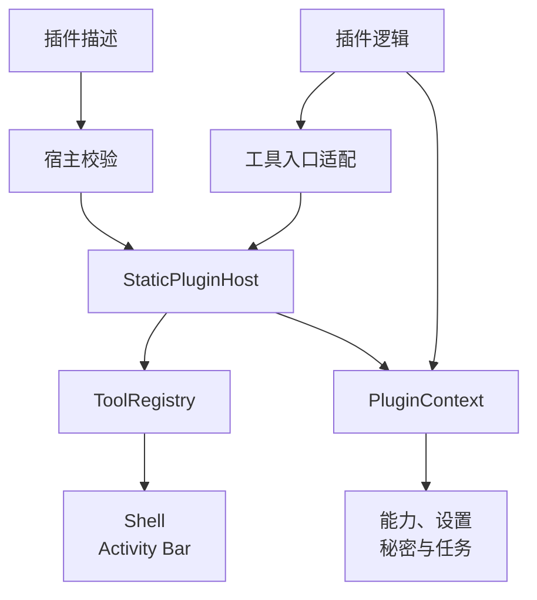

# Ramag 静态插件接口与开发手册

> 适用基线：Ramag `0.8.0` 的第一方静态 Rust/GPUI 插件。
> 更新日期：2026-10-31。
> 本文合并接口设计与开发方法；任务、状态和执行顺序只在[主线开发计划](01-development-plan.md)维护。

## 术语与命名

| 名称 | English / Acronym | 本手册中的职责 | 不表示什么 |
|---|---|---|---|
| 静态插件 | Built-in Plugin | 编译进 Ramag、通过 Rust 接口注册的工具 | 不表示可从外部目录动态加载 |
| 插件清单 | Plugin Descriptor | 描述身份、API 版本、入口、能力和设置模式 | 不表示已经授予全部权限 |
| 插件宿主 | Static Plugin Host | 按顺序注册、初始化、诊断和关闭静态插件 | 不执行外部不受信任代码 |
| 插件上下文 | Plugin Context | 在生命周期回调中标识插件并检查可用状态和能力授权 | 不提供对 Shell 或 GPUI 内部状态的直接访问 |
| 工具入口 | Tool Entry | 插件声明的稳定显示或执行入口 | 不要求复杂工作台使用标准表单 |
| 计算适配 | Compute Adapter | 无 UI、凭据和外部副作用的计算接口 | 不获得桌面文件、网络或 GPUI 能力 |

本手册适用于 `bruceblink/ramag-platform` 的静态插件 API。系统监控试点和九批保留工具迁移已进入代码基线。动态插件、插件市场、外部插件进程和跨语言 ABI 尚未实现。

## 平台与插件责任

平台负责版本校验、注册、目录、生命周期、设置、秘密、任务预算、诊断和 UI 宿主。
插件提供描述、元数据、业务逻辑和生命周期回调，通过受控上下文使用已授予的能力。
复杂数据库、API、Git、SSH、容器和系统监控工作台继续使用可信 Rust/GPUI 专用视图。
通用插件上下文不暴露 `Storage`、连接配置、文件路径、`Shell` 或 GPUI 窗口对象。

下图只表示静态登记和受控调用。布局按 A4 竖版组织；长职责在正文解释。



| 组件 | 职责与限制 |
|---|---|
| `PluginDescriptor` / `PluginEntryDescriptor` | 描述身份、API 版本、入口、能力和设置；外部插件包格式未冻结 |
| `StaticPluginHost` | 校验、注册、初始化、关闭、执行和失败隔离；不负责动态发现或进程管理 |
| `PluginContext` | 提供生命周期检查、权限、快照和有界任务；不暴露宿主内部对象 |
| `ToolRegistry` | 登记工具可见性和顺序，不作为业务服务容器 |
| `PluginCatalog` | 展示第一方入口、平台、能力和审核状态，不执行目录代码 |

## API 版本与身份

宿主 API 为 `PluginApiVersion(1, 0)`。插件主版本必须相同，插件次版本不得高于宿主。
不兼容版本在注册阶段拒绝，并记录双方版本；插件发布版本不能替代 API 兼容检查。
未来若引入非 Rust 承载方式，身份、版本和能力校验仍须在创建任务或视图前完成。

| 项目 | 接口上限与兼容要求 |
|---|---|
| `PluginId` | 小写 ASCII 稳定标识，最多 `64` 字节；显示名称不作身份 |
| 入口 | ID 最多 `128` 字节，单插件最多 `16` 个，ID 在插件内唯一 |
| 旧单入口描述 | 未显式提供 `entries` 时由宿主生成兼容入口 |
| 输入/输出声明 | `Text`、`Json` 或 `Binary`；入口载荷声明最多 `4 MiB`，实际执行还受任务结果预算限制 |
| 描述校验 | 名称、说明、设置和入口遵守领域上限；重复入口或缺少主入口时整组拒绝 |

## 能力范围

插件必须使用稳定的小写 ASCII `PluginId`，入口 ID 必须与工具元数据 ID 一致。宿主当前接受的能力只有 `ui.entry`、`ui.notification`、`storage.plugin` 和 `task.scoped`。插件不能直接读取全局配置、其他插件设置、凭据、连接配置或 `ramag-ui` 内部对象。

| 能力 | 允许用途 | 边界 |
|---|---|---|
| `ui.entry` | 登记和显示入口 | 不直接修改 Shell 或创建外部窗口 |
| `ui.notification` | 宿主内通知 | 不发送外部消息 |
| `storage.plugin` | 当前插件的普通/敏感快照 | 不读取原始存储、其他插件或用户连接 |
| `task.scoped` | 受生命周期约束的有界任务 | 不创建无限任务或绕过取消 |

任意文件、网络、子进程、系统密钥环和数据库访问不属于上述默认能力。

## 创建工具插件

插件实现 `ramag_domain::Tool`，把工具身份集中在 `ToolMeta`，再用 `StaticPluginAdapter` 接入宿主：

```rust
use std::sync::Arc;
use ramag_app::{StaticPluginAdapter, StaticPluginHost};
use ramag_domain::{Tool, ToolMeta};

struct ExampleTool { meta: ToolMeta }

impl ExampleTool {
    fn new() -> Self {
        Self { meta: ToolMeta::new("example", "Example", "A bounded example tool") }
    }
}

impl Tool for ExampleTool {
    fn meta(&self) -> &ToolMeta { &self.meta }
}

fn register_example(host: &StaticPluginHost) -> Result<(), Box<dyn std::error::Error>> {
    let tool: Arc<dyn Tool> = Arc::new(ExampleTool::new());
    host.register_plugin(Arc::new(StaticPluginAdapter::from_tool(tool)?))?;
    Ok(())
}
```

需要自定义资源清理时，实现 `StaticPlugin` 的 `initialize` 和 `shutdown`。初始化失败只禁用当前插件；宿主继续处理后续插件。关闭按成功初始化的逆序执行，关闭后的 `PluginContext::ensure_available` 会拒绝迟到调用。

正常生命周期依次为注册、初始化中、就绪、关闭中和卸载。注册失败撤销当前插件入口与目录登记；
初始化失败停止当前插件任务并记录 `Initialize` 错误；关闭失败记录 `Shutdown` 错误并继续处理其他插件。
卸载时发送取消信号，已保存的上下文拒绝迟到调用。错误与诊断只保留有界摘要，不回显秘密或请求正文。

## 多入口和标准入口

一个插件可以通过 `PluginDescriptor::with_entries` 声明多个 `PluginEntryDescriptor`。每个入口必须有稳定 ID、显示名称、输入/输出数据类型和载荷上限；所有入口由宿主一次校验、一次注册，任一入口无效时整组拒绝。复杂工作台可以注册自己的 GPUI 视图，轻量入口使用平台标准入口面板，不得把网页页面嵌入桌面窗口。

入口执行必须经过 `StaticPluginHost::execute_entry`。宿主先检查插件状态、入口 ID、输入大小、任务能力、超时和结果字节预算；插件不能绕过宿主直接创建无限任务或把结果写入其他插件状态。

需要记录成功入口运行指标时，使用返回的 `PluginTaskExecution::join_with_metrics()`。它返回 `PluginTaskCompletion`，可读取受预算保护的结果、`elapsed()` 和 `output_bytes()`；需要同时记录取消、超时或失败时，使用 `join_with_outcome()` 返回的 `PluginTaskOutcome`。普通调用继续使用 `join()`，以保持只关心结果的接口不变。`elapsed()` 从任务提交开始计时，包含调度等待，只用于 headless 运行记录，不等同于 GPUI 首帧时间或进程级内存测量。

任务预算由 `ramag-app::plugin_tasks` 执行：单插件最多 `8` 个活动任务，名称最多 `128` 字节且
拒绝控制字符，最长运行 `60s`，单次结果最多 `1 MiB`。入口上限可以进一步收紧预算。
输入先检查大小再占用任务名额；超时、关闭、卸载和用户取消都发送取消信号。
入口执行错误最多保留 `512` 字节，并保持 UTF-8 边界。接口声明的 `4 MiB` 不放宽任务结果的 `1 MiB` 限制。

## 第一方目录和双端核心

每个静态插件注册成功后，宿主会从 `catalog_entries` 生成第一方目录项。默认实现只声明桌面原生支持；只有已经提供独立 Web/WASM 计算适配的入口才允许覆盖该方法并标记 `web: true`。目录记录 API 版本、能力、数据处理范围和审核状态，不执行目录中的代码。

```rust
use ramag_app::PluginCatalogEntry;

impl StaticPlugin for ExamplePlugin {
    // descriptor/tool/execute implementations omitted
    fn catalog_entries(&self) -> Vec<PluginCatalogEntry> {
        self.descriptor()
            .entry_descriptors()
            .iter()
            .map(|entry| {
                PluginCatalogEntry::desktop_only(self.descriptor(), entry)
                    .with_web_support(true)
            })
            .collect()
    }
}
```

桌面端直接调用现有工具的 Rust 核心；Web 端由 `it-tools-template` 按自己的技术栈独立实现。Ramag 的 WASM 适配不在当前路线内，不能获得桌面凭据、网络、文件系统或 GPUI 能力。此前的 JSON Path/WASM 参考实现已经移除；新的计算插件只有在用户明确说明后才进入计划。

## 插件设置和敏感数据

普通设置只通过 `PluginSettingsSnapshot` 进入插件，敏感设置只通过 `PluginSecretStore` 进入插件。插件不得把密码、令牌、连接配置、原始业务数据或完整请求正文写入日志、目录元数据、普通设置或错误文本。跨项目数据交换不属于当前插件平台范围；如需增加，必须先得到用户明确说明并单独设计数据边界。

## 清单、设置和生命周期

需要声明完整描述时，使用 `PluginDescriptor::new`，再通过 builder 添加说明、能力和设置。设置只允许 `Boolean`、`Integer`、`String`、`Enum` 和 `StringList`，并受数量、长度和枚举值上限约束。API 主版本不同、重复插件 ID、重复入口 ID、未知能力、非法设置键和默认值类型错误都会在注册阶段返回诊断。

`ramag-bin` 在启动时创建 `StaticPluginHost`，注册内置工具后调用 `initialize_all`；退出时调用 `shutdown_all`。插件状态包括 `Registered`、`Initializing`、`Ready`、`ShuttingDown`、`Failed` 和 `Unloaded`。一个插件失败不得阻塞其他插件，也不得让失败插件继续出现在可用工具列表中。

### 能力授予和运行时检查

清单中的能力声明只说明插件需要什么，不能自动获得权限。宿主通过 `PluginPermissionPolicy` 按插件 ID 显式授予能力，再用 `PluginContext::require_capability` 包住每一次受控服务调用。该检查会先验证插件仍处于可用生命周期，再验证能力已在清单中声明且已由策略授予；默认策略不授予任何能力。读取设置和秘密快照同样要求宿主授予 `storage.plugin`。

### 设置命名空间和运行时快照

宿主使用 `PluginSettingsSnapshot::from_namespaced_values` 读取某个插件的候选设置。完整键必须以 `plugin.<plugin-id>.` 开头，并且键名和值类型必须出现在该插件清单中；其他插件命名空间、未知键、重复键、敏感设置、类型不匹配和超出字符串/列表上限的值都会返回 `PluginSettingsError`。缺失值只使用清单默认值补齐。敏感设置始终排除在普通快照之外。

设置修改通过 `update` 或 `update_namespaced` 生成新快照，旧快照保持不变；普通快照只包含通过清单校验的完整值集。持久化、迁移和秘密存储分别通过下列接口处理。

`PluginSettingsStore` 将快照编码为版本 1 的 JSON 包络，使用 `plugin.<plugin-id>.__snapshot.v1` 保存主记录，并在替换前把旧主记录复制到 `plugin.<plugin-id>.__snapshot.backup.v1`。读取主记录失败时自动校验备份；两者都损坏时返回恢复失败，宿主不得启动受影响插件。备份和主记录只保存普通设置，敏感设置由秘密存储单独处理。

需要升级旧包络时，宿主通过 `PluginSettingsMigrator` 注册连续的版本步骤。每一步在内存中接收和返回有界的命名空间映射，所有步骤成功且生成的新快照通过清单校验后才可交给插件；迁移函数返回失败、缺少步骤或超过步骤上限都会拒绝启动，并保留主记录以便备份恢复。迁移不会自动写回配置，避免失败流程覆盖可恢复数据。

敏感设置必须使用 `PluginSecretStore`，不能放入普通设置快照。秘密快照只接受清单中 `sensitive` 为真的键，宿主使用 `Storage::seal` 和 `Storage::unseal` 保存到独立的 `plugin.<plugin-id>.__secrets.v1` 密文键，并保留加密备份。密文前缀、包络版本、明文和密文大小都会校验；插件命名空间、普通设置键、类型或格式不匹配会被拒绝，日志和错误不会输出秘密正文。`StaticPluginHost` 在调用 `initialize` 前加载两个快照并写入 `PluginContext`；加载、恢复或迁移失败会禁用当前插件并从工具注册表移除。Windows Credential Manager、主密钥和秘密上下文真实链路已完成；Linux Secret Service、macOS Keychain 和正式发布环境仍需分别验收。

## 测试和验收

插件至少覆盖清单校验、重复入口、初始化失败隔离、逆序关闭、迟到上下文调用、未声明/未授予能力拒绝、设置命名空间隔离、类型/大小校验、不可变快照更新、主记录备份恢复、双记录损坏拒绝、迁移失败回退和秘密密文读写，以及 Activity Bar 和设置诊断在 360/1024/1440 宽度下的 headless 布局。提交前运行：

```text
cargo fmt --all -- --check
cargo clippy --workspace --all-targets -- -D warnings
cargo test --workspace --locked
pwsh -NoProfile -File scripts/windows/check-source-size.ps1
git diff --check
```

真实 Windows 窗口截图和键盘操作仍需单独完成；headless 测试不能替代真实窗口证据。

## 当前未实现能力

当前版本不能安装或加载第三方动态插件，不能执行插件包中的外部代码，不能从远程市场发现或升级插件，也没有跨语言 ABI、签名验证、沙箱、安装回滚和独立插件进程。用户明确要求这些能力时，先更新[主线开发计划](01-development-plan.md)，完成威胁模型、权限边界和协议决策，再安排实现。

## 承载与兼容决策

| 方式 | 结论与边界 |
|---|---|
| 编译期静态 Rust/GPUI | 当前采用，复用工具 crate、类型系统和主程序发布流程 |
| WASM/WASI 计算适配 | 仅保留为无 UI、凭据、网络的计算候选，不作为桌面宿主 |
| 运行时动态库 | 当前排除，ABI、崩溃隔离、签名与分发未形成完整方案 |
| 进程外 IPC 插件 | 需求明确后再设计握手、权限、消息上限、恢复和安装回滚 |
| WebView | 排除，不作为原生工作台的嵌入方式 |

插件新增可选描述时保持 API 主版本；新增 API 次版本能力必须显式声明并支持旧宿主拒绝。
API 主版本变化另建接口。入口 ID、设置键或能力重命名按兼容性变化处理，提供迁移或保留旧标识。
静态插件随 Ramag 主程序升级；这些决定不批准外部插件分发、第三方代码或恢复已移除工具。

## 安全边界与验证

| 风险 | 现有控制 | 未覆盖范围 |
|---|---|---|
| 跨插件读取设置 | 命名空间校验和不可变快照 | 动态外部代码隔离 |
| 绕过服务权限 | 生命周期、声明和授予检查 | 进程外协议 |
| 任务或结果无限增长 | 数量、时间、取消和字节预算 | 恶意进程的 OS 级隔离 |
| 初始化或关闭失败 | 单插件失败隔离、逆序关闭和诊断 | 外部进程崩溃恢复 |
| 秘密泄露 | 独立密文存储与有界错误 | 第三方审计与签名 |
| API 不兼容 | 主次版本校验 | 多版本外部包仓库 |

接口维护需核对身份、权限、设置、入口、失败恢复、卸载，以及原有流程、配置、凭据、数据和工具顺序。
通过领域清单测试、宿主测试、Headless GPUI 和目标平台构建后，再记录真实窗口的对应操作。
文档维护检查接口字段、术语和图表；回滚仅涉及本次接口或文档差异，不删除用户数据。

## 交付顺序

1. 先更新主线文档中的设计确认和验收条件。
2. 在 `ramag-domain` 定义有界实体和纯计算核心，再在 `ramag-app` 编排宿主服务。
3. 在 `ramag-tool-*` 中实现 GPUI 视图，并在 `ramag-bin` 完成依赖装配。
4. 通过目标测试、对应 UI 验收和 workspace 检查后，创建英文 Conventional Commit。推送遵守用户授权和仓库流程。

插件维护先明确一个可独立验证的改动，复用现有目录、设置和工具入口。
新增计算入口或双端适配须由用户明确提出，再写入主线开发计划。
