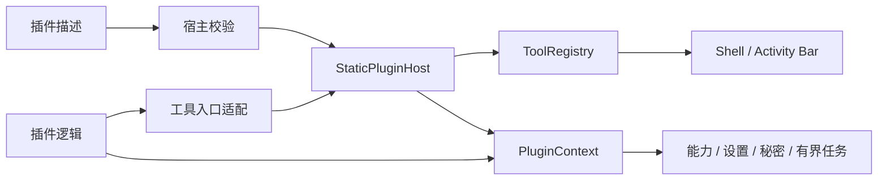

# RAMAG-PLUGIN-DESIGN-001：插件 API 与承载方式设计

> 状态：设计初稿，供 `RAMAG-PLUGIN-PILOT-001` 评审前使用。
>
> 日期：2026-10-27。
>
> 范围：只定义静态插件 API、宿主边界和后续承载方式决策。本文不加载外部代码，不新增业务功能，不改变现有工具注册、用户数据或凭据。

## 术语与责任

| 名称 | English / Acronym | 本文职责 | 不表示什么 |
|---|---|---|---|
| 插件描述 | Plugin Descriptor | 描述插件身份、API 版本、入口、能力和设置模式 | 不表示插件已经获得全部能力 |
| 工具入口 | Tool Entry | 描述一个可显示、可执行或可打开的稳定入口 | 不表示复杂工作台必须使用标准表单 |
| 插件宿主 | Plugin Host | 校验、注册、初始化、诊断和关闭插件 | 不表示宿主加载任意外部代码 |
| 插件上下文 | Plugin Context | 为插件提供受控的身份、权限、设置和任务接口 | 不包含 `Shell`、`Window` 或 `gpui::Context` |
| 静态插件 | Built-in Plugin | 编译进主程序、由 Rust 接口注册的插件 | 不表示动态插件格式已经开放 |
| 计算适配 | Compute Adapter | 把无 UI、无凭据和无外部副作用的计算核心适配到 Web/WASM | 不获得桌面文件、网络或 GPUI 能力 |

## 设计目标与边界

设计目标：

1. 把插件身份、入口、生命周期和权限从业务工具组合细节中分离。
2. 保留现有 `ramag-tool-*` 的用户行为、协议、数据、凭据和工具顺序。
3. 让单个插件注册或初始化失败只影响该插件，并提供有界、可读的诊断。
4. 让任务取消、输入输出大小、超时和结果内存有明确上限。
5. 为第一方静态插件提供稳定的接口约定，再决定是否需要运行时承载方式。

当前不进入实现：

- 外部目录扫描、第三方插件市场、动态库加载、任意外部进程、自动更新和跨语言 ABI。
- 插件直接访问数据库、SSH、系统密钥环、任意文件、任意网络或子进程。
- 插件把页面嵌入 WebView，或直接持有宿主 `Shell`、GPUI 窗口和内部实体。
- 通过插件恢复已移除的本机协作或 JSON Path 独立工具。

## 当前代码基线

当前实现已经提供静态插件基线：

| 组件 | 当前职责 | 本设计的边界 |
|---|---|---|
| `PluginDescriptor` / `PluginEntryDescriptor` | 描述插件身份、入口、输入输出、能力和设置 | 作为 `ramag.plugin.v1` 的 Rust 基线；外部格式尚未冻结 |
| `StaticPluginHost` | 注册、初始化、关闭、执行和失败隔离 | 不负责动态发现、进程管理或远程分发 |
| `PluginContext` | 检查生命周期、能力、设置秘密快照和有界任务 | 不暴露 `Storage`、文件路径、连接配置或 GPUI 对象 |
| `ToolRegistry` | 管理工具入口、可见性和顺序 | 仍是入口登记组件，不升级为通用服务容器 |
| `PluginCatalog` | 展示第一方入口、平台、能力、数据处理和审核状态 | 目录显示不等于执行插件代码 |
| `ramag-ui` 插件诊断页 | 展示目录、可用入口、状态和失败阶段 | 只呈现宿主已校验的快照 |

现有实现和测试继续作为设计的行为基线。新增接口不能复制业务服务实例，也不能改变生产组合根的生命周期顺序。

## API 版本与身份

### 版本

- 当前宿主 API 为 `PluginApiVersion(1, 0)`。
- 插件主版本必须与宿主主版本相同；插件次版本必须小于或等于宿主次版本。
- 主版本不同或插件声明了宿主不能提供的次版本时，注册阶段拒绝插件，并记录插件版本和宿主版本。
- API 版本与插件自身发布版本分开。插件发布版本不能替代 API 兼容检查。
- 未来如果出现非 Rust 承载方式，握手必须先传递相同的 API 主次版本和能力集合；握手失败时不创建插件任务或视图。

### 身份和入口

- `PluginId` 使用小写 ASCII 稳定标识，最多 64 字节；显示名称不是身份。
- 入口 ID 最多 128 字节，单个插件最多 16 个入口；入口 ID 在插件内必须唯一。
- 单入口旧描述继续兼容；缺少显式 `entries` 时由宿主生成兼容入口。
- 入口输入和输出只声明 `Text`、`Json` 或 `Binary`，每次载荷最多 4 MiB。
- 插件描述、入口名称和说明使用已有字节上限；超限、重复或缺失主入口在注册前拒绝。

## 平台与插件责任边界



平台负责：

- 版本、身份、入口、能力和设置模式校验。
- 注册表登记、目录快照、生命周期顺序、失败隔离和诊断。
- GPUI `Shell`、Activity Bar、标准入口渲染、通知和页面生命周期。
- 设置快照、秘密快照、迁移、备份、任务取消、超时和结果上限。

插件负责：

- 提供经过校验的描述、`Tool` 元数据和可选生命周期回调。
- 通过 `PluginContext` 请求已声明且已授予的能力。
- 在入口执行中遵守输入、输出、任务和取消约定。
- 不保存宿主对象，不绕过宿主写入配置、凭据、连接或其他插件状态。

复杂数据库、API、Git、SSH、容器和系统监控工作台继续使用可信 Rust/GPUI 专用视图。标准入口只处理轻量输入、输出、复制、错误和快捷键。

## 生命周期与失败行为

生命周期固定为：

```text
发现 → 校验 → 注册 → 初始化中 → 已就绪 → 关闭中 → 已卸载
                         └→ 失败
```

- 注册失败：撤销当前插件的入口和目录登记，保留其他插件。
- 初始化失败：停止当前插件任务，移除其可用入口，记录 `Initialize` 阶段和有界错误。
- 关闭失败：继续关闭其他插件，记录 `Shutdown` 阶段，最终仍释放当前插件资源。
- 卸载后：插件上下文拒绝迟到调用；旧任务收到取消信号。
- 插件诊断不回显秘密、令牌、连接配置、完整请求正文或无限长错误。

## 能力、设置与秘密

第一阶段只允许以下能力：

| 能力 | 作用 | 明确排除 |
|---|---|---|
| `ui.entry` | 注册和显示受校验入口 | 不能直接修改 `Shell` 或创建外部窗口 |
| `ui.notification` | 发送宿主通知 | 不能发送外部消息或写入网络 |
| `storage.plugin` | 读取当前插件的普通/敏感快照 | 不能读取原始存储、其他插件命名空间或用户连接 |
| `task.scoped` | 创建受数量和生命周期约束的任务 | 不能创建无限线程或绕过取消 |

权限规则：

1. 清单声明能力不等于获得能力。
2. `PluginPermissionPolicy` 按插件 ID 授权；默认不授权。
3. 每次受控服务调用先检查生命周期，再检查声明和授予状态。
4. 网络、任意文件、子进程、系统密钥环和任意数据库访问不属于第一阶段默认能力。

设置规则：

- 普通设置使用 `plugin.<plugin-id>.*` 命名空间和校验后的不可变快照。
- 敏感设置只进入 `PluginSecretStore`；普通设置、目录、日志和错误不包含敏感值。
- 迁移在内存中完成，经过清单校验后才替换快照；迁移失败保留旧主记录和备份。
- 插件不能读取全局设置、其他插件设置、配置文件路径或原始存储对象。

## 任务取消与资源上限

- 单个插件最多 8 个活动任务。
- 任务名称最多 128 字节，拒绝控制字符。
- 任务最长 60 秒；超时、关闭、卸载和用户取消都发送取消信号。
- 单次结果最多 1 MiB；入口声明的输出上限可以进一步收紧该值。
- 输入先检查入口上限，再创建任务；失败不会消耗任务名额。
- 入口执行错误最多保留 512 字节，并保持 UTF-8 边界。
- 运行指标只表示任务提交后的耗时和输出字节数，不代表 GPUI 首帧、进程内存或跨平台性能。

## 承载方式决策

| 方式 | 当前结论 | 原因和边界 |
|---|---|---|
| 编译期静态 Rust/GPUI | **第一阶段采用** | 复用当前工具 crate、类型系统和发布流程；便于保留凭据、协议和窗口边界 |
| WASM/WASI 计算适配 | **仅保留为计算候选** | 适合无 UI、无凭据、无网络和有界输入输出的纯计算；不作为桌面插件宿主，不获得 GPUI 能力 |
| 运行时动态库 | **当前排除** | Rust ABI、崩溃隔离、签名、升级回滚和跨平台分发成本未形成可接受方案 |
| 进程外 IPC 插件 | **后续候选** | 只有外部代码需求明确且完成握手、权限、消息上限、崩溃恢复和安装回滚设计后才评估 |
| WebView/嵌入式网页 | **排除** | 不符合桌面原生 GPUI 方向，也会扩大凭据、窗口和网络边界 |

这个决策不批准第三方代码，也不产生动态插件 ABI。若未来外部代码需求成立，必须新增独立威胁模型和协议设计，不修改本文件的静态基线。

## 兼容与发布规则

| 变化 | 处理方式 |
|---|---|
| 插件自身补充可选描述 | 保持同一 API 主版本；缺省值由宿主按清单规则补齐 |
| API 次版本增加能力 | 新能力必须显式声明、授权并提供旧宿主拒绝行为 |
| API 主版本变化 | 新建主版本接口；旧宿主拒绝新插件，旧插件不自动迁移 |
| 入口 ID、设置键或能力重命名 | 视为兼容性变化，提供迁移或保留旧标识，不静默复用旧数据 |
| 静态内置插件升级 | 随 Ramag 主程序发布，使用现有 Git tag、安装包和校验清单流程 |
| 外部插件分发 | 当前不支持；签名、来源、安装、升级和回滚设计完成前不实现 |

## 最小威胁模型

| 威胁 | 当前控制 | 未覆盖范围 |
|---|---|---|
| 插件读取其他插件设置 | 命名空间校验和宿主快照接口 | 动态外部代码隔离 |
| 插件绕过权限访问服务 | 声明、授予和每次调用检查 | 进程外协议实现 |
| 无限任务或超大结果 | 任务数、超时、取消和字节上限 | 恶意本地进程的 OS 级资源隔离 |
| 初始化或关闭失败阻塞宿主 | 单插件失败隔离、逆序关闭和诊断 | 外部进程崩溃恢复策略 |
| 错误泄露秘密 | 有界错误和禁止敏感正文进入日志 | 第三方代码审计和签名 |
| 版本不兼容 | API 主次版本检查和入口校验 | 多版本外部包仓库 |

## 试点进入条件

`RAMAG-PLUGIN-PILOT-001` 在本设计通过维护者评审前不启动。启动前必须满足：

- 选定一个现有低风险能力，不增加新的业务功能。
- 明确该能力的入口、设置、能力授权、错误恢复和卸载流程。
- 通过 `ramag-domain` 清单校验、`ramag-app` 宿主测试、`ramag-ui` Headless 布局和目标平台构建。
- 真实窗口只验收入口、状态和回滚行为，不把启动成功扩大为插件功能完成。
- 记录原有用户流程、配置、凭据、数据和工具顺序的兼容证据。

## 本设计的验收与回滚边界

验收范围：

- 文档结构、术语、职责、承载决策和接口字段与当前代码一致。
- 现有静态插件测试、插件诊断 UI、工作区格式、严格 Clippy、源码尺寸和差异检查继续通过。
- 本设计不要求 Docker、外部数据库、远程服务或动态插件运行；这些检查标记为“不适用”。

回滚边界：只回滚本设计文档、文档链接和设计状态记录；不回滚现有插件宿主、工具注册、设置、秘密或任务实现，不删除用户数据。

## 后续步骤

1. 由维护者评审本文的静态基线、WASM 计算边界和外部承载排除理由。
2. 评审通过后，在 `RAMAG-PLUGIN-PILOT-001` 中选择一个现有低风险能力，并记录独立回滚范围。
3. 在试点通过前，不开放动态加载、第三方插件、远程市场或新的跨语言 ABI。

